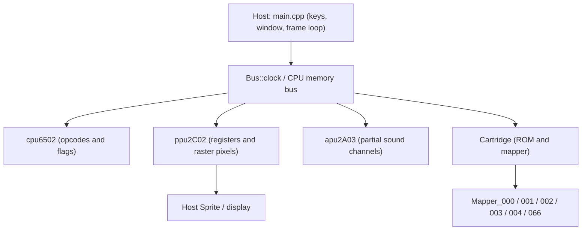

# KairoNES: a guided journey from a ROM to a pixel

This guide is a teaching companion to [the ordered source map](SOURCE_READING_ORDER.md). Start from the code, return to this narrative when a hardware abstraction is unfamiliar, and then inspect the referenced methods. The examples describe **the implementation in this repository**, not a promise of complete, cycle-accurate NES compatibility.

## 1. What is being emulated?

An NES program does not call operating-system APIs such as "draw a triangle" or "play a sound." It executes instructions on an emulated 6502-family processor. The CPU reads/writes addresses that refer to multiple hardware devices. The PPU constructs video pixels from pattern, nametable, palette and sprite state. The APU synthesizes sound signals. A cartridge contains program and graphics data and sometimes a memory-bank controller called a *mapper*.

The host app in [`main.cpp`](../NESEmulator/main.cpp) provides keyboard, a window and a way to display the PPU output through an adapted PixelGameEngine. It should not decide how an NES instruction or PPU register behaves.

### Follow a real operation

Suppose the CPU executes a store to `$2000`. The opcode implementation is in [`cpu6502.cpp`](../NESEmulator/cpu6502.cpp). Its memory write calls `Bus::cpuWrite` in [`Bus.cpp`](../NESEmulator/Bus.cpp). The bus forwards the appropriate mirrored PPU register address to `ppu2C02::cpuWrite` in [`ppu2C02.cpp`](../NESEmulator/ppu2C02.cpp). The next PPU dots use the changed control state. The host receives a rendered screen after a frame completes. This is why changing `main.cpp` to draw directly into a framebuffer would not emulate the hardware side effect.

## 2. The CPU address map

| CPU address range | Device in the current implementation | Why it matters |
| --- | --- | --- |
| `$0000-$1FFF` | 2 KiB internal RAM, mirrored | The address decoder uses `addr & 0x07FF`; physical RAM is smaller than its visible range |
| `$2000-$3FFF` | PPU register mirror | Only eight register addresses exist; `addr & 7` determines the register |
| `$4000-$4013`, `$4015` | APU registers | Audio channel controls and status have read/write side effects |
| `$4014` | Sprite/OAM DMA | Copies sprite bytes while CPU execution is stalled |
| `$4016-$4017` | Controllers (with APU overlap) | Controller bits latch and shift when read; read/write semantics differ |
| `$6000-$FFFF` | Cartridge-dependent | The mapper may provide cartridge RAM, bank-register side effects and PRG ROM windows |

**Read**: [Bus.cpp](../NESEmulator/Bus.cpp), then [Cartridge.cpp](../NESEmulator/Cartridge.cpp). Unlike a plain array, a memory bus can return a different value on repeated reads if the device has state (controllers, PPU status).

## 3. How the instruction table works

[`KairoNES.cppm`](../NESEmulator/KairoNES.cppm) declares CPU state: program counter `pc`, accumulator `a`, index registers `x`/`y`, stack pointer `stkp`, and `status` bits `C Z I D B U V N`. [`cpu6502.cpp`](../NESEmulator/cpu6502.cpp) defines a 256-entry lookup table. Each entry pairs an instruction's *addressing mode* with its *operation* and base cycle count.

These are two separate questions:

- **Where does the operand come from?** Immediate, zero page, absolute, indexed, indirect, or implied addressing determines `addr_abs`, `addr_rel` and `fetched`.
- **What does the opcode do?** `ADC`, `SBC`, `LDA`, branches, shifts, stack operations and so on change registers, flags and sometimes memory.

For example, `LDA $0200,X` first resolves the effective address using indexed absolute addressing, then `LDA` fetches the addressed byte and updates accumulator and N/Z. A branch condition instead uses the relative displacement and may add cycles if it is taken or crosses a page.

**Important limitation**: the current `cpu6502::clock` executes the instruction's state transition when it begins and then counts down remaining cycles. This is not a perfect cycle-by-cycle reproduction of internal 6502 bus micro-operations. The NES 2A03 also ignores BCD decimal arithmetic even if the D status flag can be set.

### Interrupts

The PPU can request a nonmaskable interrupt (NMI), commonly at vertical blank. A mapper may request an IRQ. The bus detects these signals and calls `cpu.nmi()` or `cpu.irq()`. Both save enough CPU state on stack page `$0100` to resume the interrupted program; `RTI` later restores it. An NMI is not blocked by the interrupt-disable `I` flag, whereas IRQ normally is.

## 4. How a cartridge changes the same program address

[`Cartridge.cpp`](../NESEmulator/Cartridge.cpp) reads ROM metadata and allocates PRG/CHR bytes. **It does not implement every mapper**. Each mapper in [`Mapper_000.cpp`](../NESEmulator/Mapper_000.cpp), [`Mapper_001.cpp`](../NESEmulator/Mapper_001.cpp), [`Mapper_002.cpp`](../NESEmulator/Mapper_002.cpp), [`Mapper_003.cpp`](../NESEmulator/Mapper_003.cpp), [`Mapper_004.cpp`](../NESEmulator/Mapper_004.cpp) and [`Mapper_066.cpp`](../NESEmulator/Mapper_066.cpp) implements its own CPU/PPU mapping and optional IRQ/mirroring behavior.

- **NROM / mapper 0:** fixed mapping and 16 KiB PRG mirroring. Best first model.
- **MMC1 / mapper 1:** serial writes control PRG/CHR banks and mirroring.
- **UxROM / mapper 2:** switchable lower PRG bank; fixed upper bank.
- **CNROM / mapper 3:** CPU-controlled CHR pattern-bank switching.
- **MMC3 / mapper 4:** several PRG/CHR windows and IRQ counter. The code has incomplete PRG-RAM protection handling.
- **GxROM / mapper 66:** select both PRG and CHR banks with a control byte.

The mapper gives the cartridge either a translated byte offset, an internally handled value, or an "unmapped" signal. It should never return an offset outside allocated PRG/CHR memory. **Known risk**: the loader currently marks unsupported mappers valid and lacks adequate read/size checks; use untrusted ROMs only after this is fixed.

## 5. PPU, sprites and display are different layers

The PPU does not simply copy a stored background image onto the screen. The software models rendering state over scanlines/dots: nametable selects tile IDs, the pattern table supplies pixel bits, attribute data picks palettes, sprites add OAM-driven overlays, and palette RAM resolves colors. `ppu2C02::clock` moves this state forward. `ppu2C02::GetScreen` returns the resulting host Sprite to the UI.

CPU-side `ppu2C02::cpuRead/cpuWrite` and PPU-side `ppu2C02::ppuRead/ppuWrite` are **not** interchangeable APIs. The former expose CPU registers; the latter access the PPU's own address space, including cartridge-provided CHR banks.

The host UI may also call `GetPatternTable` to *visualize* tiles. That debug visualization is not a substitute for the normal raster pipeline. For consistency, check scrolling, sprite-zero hits, NMI timing and mapper-driven pattern changes with dedicated test ROMs.

## 6. Audio is not frame time

[`apu2A03.cpp`](../NESEmulator/apu2A03.cpp) models partial sound channels and register effects. [`main.cpp`](../NESEmulator/main.cpp) currently chooses `EmulatorUpdateWithoutAudio` from its active update callback; an audio-synchronized alternative exists but is not the active path. `Bus::clock` can return an audio-sample-ready signal independent of the PPU's frame completion.

Distinguish three timescales: the **console hardware clock**, the **host display refresh**, and the **host audio sample rate**. Treat a visual frame as the unit to display, not the unit in which CPU instructions magically happen. The emulator's audio path needs further hardware verification.

## 7. Interfaces, language features and third-party APIs

The public declaration file is a C++23 module interface. `export module Kairo.NES;` publishes names, while implementation units use `module Kairo.NES;` to define functions. `std::shared_ptr<Cartridge>` is shared ownership between bus and PPU: neither should keep a raw pointer after cartridge destruction.

The adapted PixelGameEngine supplies `OnUserCreate`/`OnUserUpdate` lifecycle methods, keyboard APIs such as `GetKey`, and drawing calls such as `DrawSprite`. Those are **host utilities**, not original NES APIs. [`KairoPixelGameEngine.cppm`](../NESEmulator/KairoPixelGameEngine.cppm) contains third-party/adapted code whose provenance must be audited before license claims. Read [third-party notices](../THIRD_PARTY_NOTICES.md) before redistribution.

## 8. What to test before claiming compatibility

1. **Cartridge parser**: valid iNES header, truncated headers/PRG/CHR, incorrect signature, huge bank counts, unsupported mapper, CHR-RAM cases and mapper offsets outside bounds.
2. **CPU**: `nestest` instruction trace, flags, all addressing modes, branch/page-cross cycles, stack, IRQ/NMI/BRK/RTI and illegal-opcode handling.
3. **PPU**: register side effects, scrolling, sprite selection, palette mirroring, frame/NMI signals and timing-dependent cases.
4. **Mapper**: reset bank and bank-switch commands on each supported mapper, MMC1 serial data, MMC3 IRQ/mirroring and CHR-ROM versus CHR-RAM writes.
5. **APU**: register timing, channel gating, sampling stability and callback/CPU synchronization.
6. **Host**: ROM selection, input mapping, pause, frame step and clean exit.

The repository currently does not provide complete automated NES validation. A committed test ROM is not the same as an executed and compared regression test. Build instructions and ROM usage are in [README](../README.md).

## 9. Suggested hands-on exercises

First, add a bounded ROM-header validator and table-driven tests without changing emulation timing. Next, instrument a CPU trace showing PC, mnemonic, operand, A/X/Y, flags and cycles. Then write focused mapper tests and compare CPU-visible and PPU-visible bank bytes. Finally inspect one frame's tile/palette changes and one audio waveform under controlled register writes.

For each exercise, ask what **physical behavior** is being approximated, what **API** models it, what **other file** consumes it, and what **test** could prove the expected behavior. That question is the reason the files are ordered this way.
